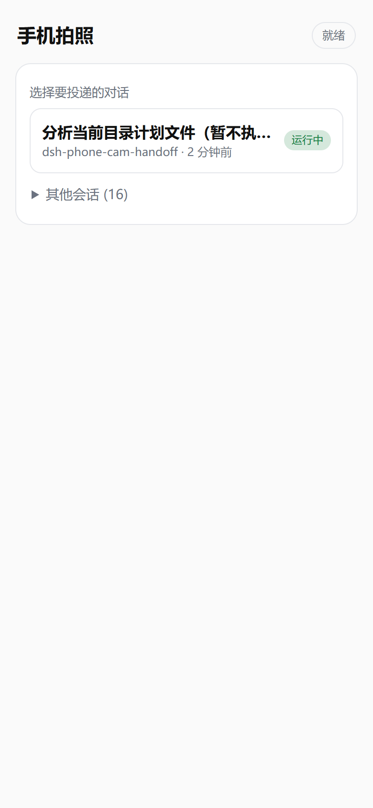

# dsh-phonephoto-ezinput

> 适用于主要使用 PC 端进行软件开发；借助本插件，可以方便地用手边的现役或已淘汰设备拍照，并把图片发送到对话窗口。

在 DSH 里开一个局域网小服务：手机扫码打开网页拍照，图片**直接投递到你指定的对话**。
手机端不装 App、不需要 HTTPS。

## 界面

手机端（扫码后）：



## 特性

- **手机零安装**：只用浏览器原生 `<input type="file" capture>`，纯 HTTP，不需要证书
- **投递到指定对话**：手机上先选对话再拍，图片直接进入那个对话
- **手机端预览确认**：拍完可看大图、删除、重拍，确认后才发送
- **客户端压缩**：长边 2048 / JPEG 0.85 / 自动修正 EXIF 方向，一张约 300~400 KB
- **五种投递模式**：写库不唤醒（默认）、直接写入、排队唤醒、插入当前回合
- **设置面板**：二维码、访问链接、模式切换、设备管理、有效期
- **安全默认**：仅私网、CSP nonce、magic bytes 校验、上传限速、IP 级授权

## 环境要求

- DeepSeek Harness 桌面端 `0.2.1-rc.5`（或相近版本）
- Node.js 20+（插件运行在 DSH 进程内，无需单独装）
- 手机与电脑在同一局域网

## 工作方式

```
电脑：插件起 HTTP 服务（默认 8788）→ 生成二维码
手机：扫码 → 选对话 → 拍照/选图 → 预览 → 发送
电脑：图片按 `inject.mode` 进入对话
```

## 投递模式

| 模式 | 行为 | 说明 |
|---|---|---|
| `inbox`（默认） | 作为「待发送」消息挂在对话里，下一轮对话时被带上 | 不会打断模型，也不会立刻触发回复 |
| `display` | 直接写入会话，界面可见，不唤醒模型 | |
| `followup` | 写入并排队一轮，唤醒模型 | |
| `steer` | 插入当前正在进行的回合 | |
| `draft` | 尝试放进输入框草稿 | ⚠️ 当前 DSH 版本下**不会显示**（见「已知限制」） |

运行期切换（仅本机）：

```powershell
curl "http://127.0.0.1:8788/api/mode?value=inbox"
```

## 设置面板

装好后在 **更多 → 设置 → 手机拍照** 里可以看到：

- 二维码 + 局域网链接 + 6 位备用配对码（可直接复制）
- 投递模式一键切换（立即生效，重启后保持配置文件里的值）
- 已配对设备列表：IP、剩余天数、**逐条删除**、**全部撤销**
- 配对**有效期**：1 / 3 / 7 / 30 天，落盘到 `~/.dsh/dsh-phonephoto-ezinput/settings.json`
- 运行统计：监听端口、上传次数、UI 心跳

## 安装

**必须装成真实目录**（`link:` 联接会导致 client 半边不加载）：

应用内 **设置 → 插件 → 安装本地路径包**，选择本目录。

> 若插件管理器记录的是 `link:`，可手动把 `dsh-phonephoto-ezinput` 复制到
> `~/.dsh/profiles/<profile>/node_modules/dsh-phonephoto-ezinput` 覆盖该联接。

安装/更新后**开关一次插件**（或重启应用）生效。

## 路由

| 方法 | 路径 | 鉴权 | 说明 |
|---|---|---|---|
| GET | `/api/health` | 无 | `{ ok, version, port, mode }` |
| GET | `/qr` | 仅回环 | 二维码页（含 token，勿外传截图） |
| GET | `/` | token 或已配对 IP | 手机页 |
| GET | `/api/sessions` | 同上 | `{ recent, groups, total }` |
| POST | `/api/upload` | 同上 | multipart：`files` + `sessionId` |
| POST | `/api/pair` | 短码 | 换设备 cookie |
| GET | `/api/pairing` | 同上 | 当前配对信息 |
| GET | `/api/pending` | 同上 | 草稿队列（client 半边用） |
| POST | `/api/pending/ack` | 同上 | 确认消费 |
| GET | `/api/mode` | 仅回环 | 查看/切换投递模式 |
| GET | `/api/diagnostics` | 仅回环 | 计数器、设备、模式 |
| GET/POST | `/dsh-phonephoto-ezinput/*` | 同源 | 给 DSH Web UI 的 client 半边用 |

## 配对与安全

- **已配对 IP 免 token**：首次用二维码里的 token（8 位）或 6 位短码配对后，同一 IP 之后的访问不再校验 token。
- 设备以 **IP** 为唯一键，有效期 `pairing.deviceTtlMs`（默认 7 天），每次访问滑动续期。
- 默认只接受私网来源（10/8、172.16/12、192.168/16、127/8）；`/qr`、`/api/mode`、`/api/diagnostics` 额外限制为回环。
- 页面安全头：CSP（nonce，无 `unsafe-inline`）、`no-referrer`、`no-store`、`nosniff`。
- 上传按 magic bytes 复核（JPEG/PNG/WebP），限速 12 次/分钟/IP。

## 配置

```yaml
server:   { host: 0.0.0.0, port: 8788, portRetries: 10, privateOnly: true }
pairing:  { ttlMs: 900000, persistDevices: true, pairMaxFailures: 5, deviceTtlMs: 604800000 }
upload:   { maxFiles: 4, maxBytes: 10485760, maxTotalBytes: 26214400, targetMaxEdge: 2048, quality: 0.85, ratePerMinute: 12 }
inject:   { mode: inbox, notePrefix: '[手机拍照]', sourceKind: user, pendingTtlMs: 600000 }
sessions: { recentWindowMs: 600000 }
```

## 数据落点

- 已配对设备：`$DSH_HOME/dsh-phonephoto-ezinput/devices.json`（只存 cookie secret 的 sha256 + IP + 到期时间）
- 不写临时文件；图片在内存中处理，投递后释放

## 已知限制

1. **`draft` 模式（输入框草稿）不可用**：`conversation.createDrafts()` 只登记字节，真正渲染缩略图的是输入框组件内部的 `addFiles()`，未暴露给插件。代码保留，等上游开放 API。
2. **client 半边要求真实目录安装**：`link:` 联接形态下不加载（心跳为 0 即可判定）。
3. 服务端端口被占用时自动 +1，最多试 10 次；client 会从 8788 起探测。
4. 设备按 IP 识别：同一 NAT 后的多台设备会合并成一条。
5. 草稿队列是内存态，重启即丢。

## 许可

MIT。二维码使用 [qrcode-generator](https://github.com/kazuhikoarase/qrcode-generator)（MIT, © 2009 Kazuhiko Arase），已内联到 `lib/vendor/` 并保留版权头。
